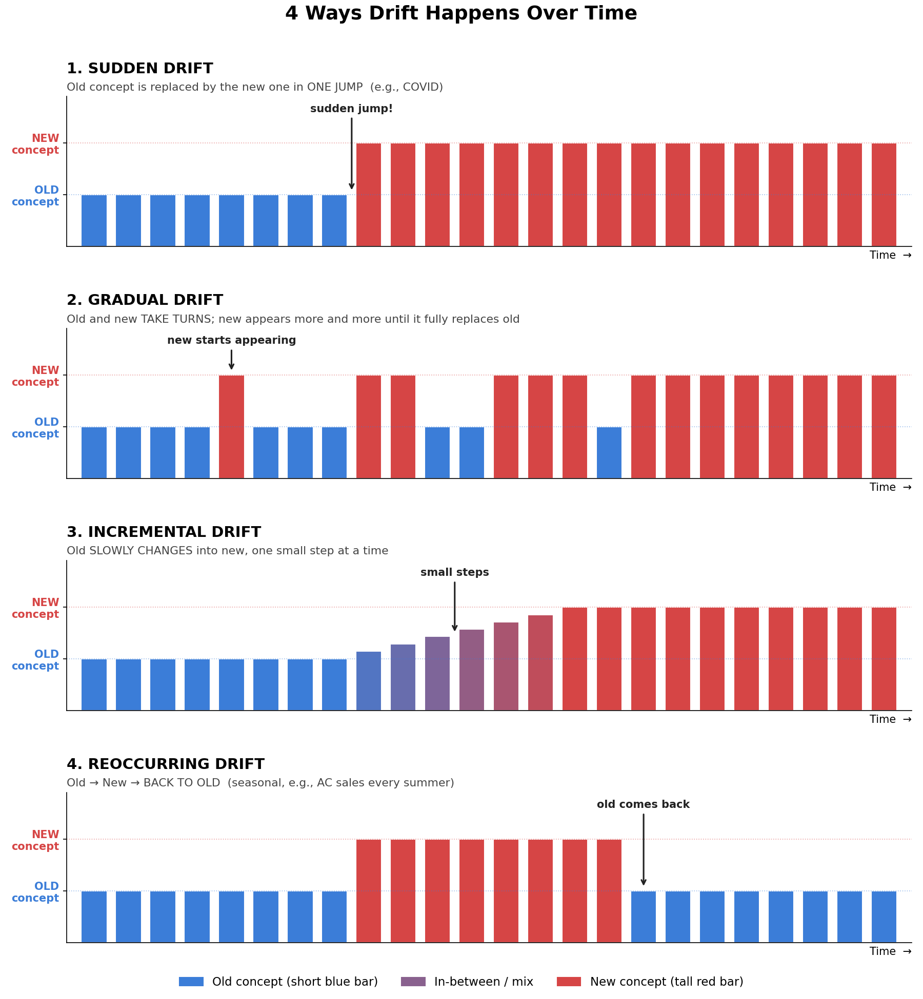
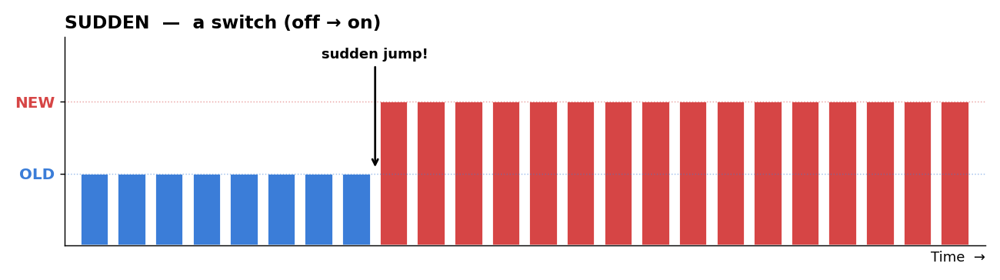
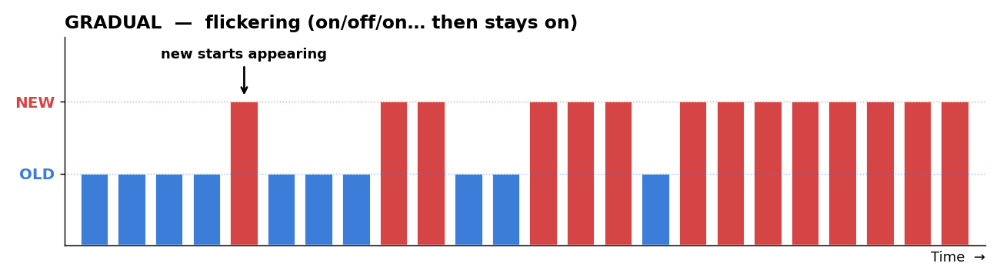
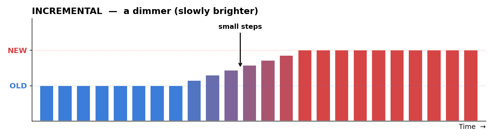
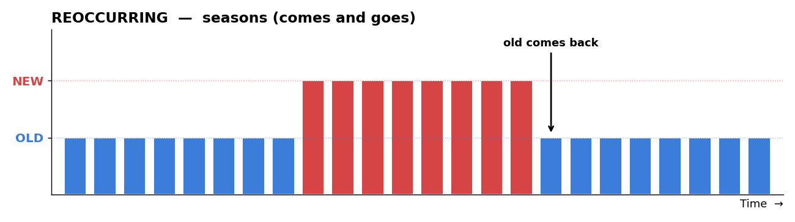

# MLOps — Introduction

════════════════════════════════════════════════════════════

# 📌 TOPIC 1 — What is MLOps?

**⭐ Definition:** MLOps is a set of practices that combines Machine Learning, DevOps and Data Engineering to reliably build, deploy, monitor and maintain ML models in production, automating the whole lifecycle from data → training → deployment → monitoring → retraining.

**MLOps = ML + DevOps + Data Engineering**

The set of practices used to **build, deploy, monitor, and maintain ML models reliably in production**.

```
        ML                 DevOps              Data Engineering
   (build models)    (ship & run them)     (feed them data)
         \                  |                   /
          \                 |                  /
           ────────────►  MLOps  ◄─────────────
```

### 1.1 ML (Machine Learning)
- Models
- Features
- Evaluation
- Experimentation
- Retraining
- Tracking & versioning (of experiments and models)

### 1.2 DevOps
- CI/CD (Continuous Integration / Continuous Deployment)
- Continuous Training (CT)
- Continuous Monitoring (CM)
- Containers (e.g., Docker)
- Versioning

### 1.3 Data Engineering
- Pipelines
- Storage
- Data quality checks
- Lineage (where the data came from and how it was transformed)
- Schemas (structure of the data: columns, data types)

> ✅ **END OF TOPIC 1 — What is MLOps?**

════════════════════════════════════════════════════════════

════════════════════════════════════════════════════════════

# 📌 TOPIC 2 — Data Sources — Client-side vs Server-side

Data pipelines collect data from **two sides**: the **client** (user's device) and the **server** (company's backend).

### 2.1 Client-side Data

**What:** Data generated on the **user's device/browser** from how the user interacts with the app.

**Example (Amazon):**
- Mouse movements
- Clicks
- Scrolls, time spent on a page

This is called **clickstream data**: it tracks everything the user does.

**Why it matters:** It helps understand **what the user likes / doesn't like** → used for personalization and recommendations.

### 2.2 Server-side Data

**What:** Data recorded on the **company's servers** when the user sends a request.

**Example (Amazon):**

```
User searches "chairs"
        ↓
Request goes to Amazon server
        ↓
Server returns search results
        ↓
User clicks on some results
        ↓
Query + results + clicks are logged on the server
        ↓
Used to train the model (e.g., search ranking)
```

> ✅ **END OF TOPIC 2 — Data Sources — Client-side vs Server-side**

════════════════════════════════════════════════════════════

════════════════════════════════════════════════════════════

# 📌 TOPIC 3 — Rule — Train on Organic Data

> **Train models on organic data (real user behaviour) as much as possible.**

- **Organic data** = features coming from real user actions (e.g., what the user actually searched and clicked).
- **Avoid synthetic / self-generated features** where possible.
- **Why:** Organic data reflects reality → most accurate model.

> ✅ **END OF TOPIC 3 — Rule — Train on Organic Data**

════════════════════════════════════════════════════════════

════════════════════════════════════════════════════════════

# 📌 TOPIC 4 — Data Quality Checks — Amazon Deequ

**Problem:** Upstream pipelines can silently change the data.

**Example:** A pipeline that always sent `"AC"` (uppercase) suddenly starts sending `"ac"` (lowercase). The model still runs, but on wrong data.

### How Deequ works

1. **Define constraints** (by the developer, based on past data) for each column:
   - Expected % of null values
   - Mean / average value
   - Percentiles (e.g., 90th percentile)
2. **Compute metrics** on the incoming data.
3. **Verify** the metrics against the constraints.
4. If a constraint is **broken** → Deequ generates a **quality report** and **alerts the team** (e.g., a daily email).

**Example:**

```
Constraint:  null % in column X  ≈ 0.5%
Incoming:    null % in column X  = 10%
        ↓
Constraint broken → Deequ quality report → email alert to team
```

**Why:** Problems are caught automatically and immediately, with no need to check dashboards manually every morning.

**Deequ:** Amazon's open-source data quality library, written in **Scala** (many alternatives exist).

> ✅ **END OF TOPIC 4 — Data Quality Checks — Amazon Deequ**

════════════════════════════════════════════════════════════

════════════════════════════════════════════════════════════

# 📌 TOPIC 5 — Lineage & Schemas

- **Lineage:** Tracks where each piece of data came from and how it evolved: which **joins, merges, and transformations** were applied.
- **Schemas:** The structure of the data (columns, data types) must be controlled for every database/table.

> **MLOps covers all of these.** As an MLOps engineer, you must **control and monitor** pipelines, storage, quality checks, lineage, and schemas.

> ✅ **END OF TOPIC 5 — Lineage & Schemas**

════════════════════════════════════════════════════════════

════════════════════════════════════════════════════════════

# 📌 TOPIC 6 — MLOps vs DevOps

| DevOps Engineer | MLOps Engineer |
|---|---|
| Works with **code** only | Works with **code + data + model** |
| | Also: **features, config, environment** |

> An MLOps engineer must manage and monitor **all** of these, not just code.

### 💡 Career Tip (from tutor)
- **Join a startup** for the first **5–6 years**, then move to a big company.
- **Startup:** you deploy and control the **entire production system** → huge learning.
- **Big company (e.g., Google):** you work on a **small part** of a giant system; often no access to production data.

> ✅ **END OF TOPIC 6 — MLOps vs DevOps**

════════════════════════════════════════════════════════════

════════════════════════════════════════════════════════════

# 📌 TOPIC 7 — How ML Systems Are Different (Axes)

### Axis 1 — What You Must Version
- Software: version **code** only.
- ML: version **code + data + model + features + config + environment** (covered in Topic 6).

### Axis 2 — What "Correct" Means

**Software:** "Correct" is **fixed and exact**. Same input → same output.

```python
assert f(x) == y        # ✅ works in software
```

**ML:** "Correct" is **not fixed**.
- Predictions/probabilities can **shift slightly** after every retraining.
- So we **cannot** test for an exact output.
- Instead, we test that a **metric meets a threshold**:

```python
assert model.predict(x) == y    # ❌ cannot do this in ML
assert roc_auc >= 0.8           # ✅ do this instead
```

**ROC-AUC:** Area under the ROC curve; measures how well the model separates classes (0.5 = random, 1.0 = perfect).

**Other tests:** latency (how fast the model responds). *(continued in next part)*

> ✅ **END OF TOPIC 7 — How ML Systems Are Different (Axes)**

════════════════════════════════════════════════════════════

════════════════════════════════════════════════════════════

# 📌 TOPIC 8 — Axes Continued — Latency & Decay

### Axis 2 (continued) — Latency Is Also Part of "Correct"

- In ML, a model is "correct" only if it is **accurate AND fast**.
- **Latency** = time the model takes to return a prediction.
- We **cannot accept high latency in exchange for accuracy**. Users will not wait.
- So besides metric tests, we also test speed:

```python
assert roc_auc >= 0.8              # accuracy test
assert p95_latency_ms <= 100       # latency test (example threshold)
```

### Axis 3 — Decay

**Question from tutor:** *What gets worse over time: deployed code or a deployed model?*

**Answer:** The **deployed model**.

| Software (code) | ML (model) |
|---|---|
| Code keeps working the same way, even a year later | Model gets **worse over time** |
| Functionality does not change by itself | The **world changes** under the model |

**Why do models decay?**
- Human behaviour is **unpredictable**: we want one thing today and something else tomorrow.
- The data the model sees in production slowly stops looking like the data it was trained on.

> **A deployed model always gets worse over time**, so it must be **monitored** continuously. (This is called **drift**; see Topic 11.)

### Summary: 3 Axes of How ML Is Different

```
Axis 1 → What you must version   → code + data + model + features + config + env
Axis 2 → What "correct" means    → metric thresholds (not exact outputs) + low latency
Axis 3 → Decay                   → deployed models get worse over time → monitor them
```

> Everything we do in ML (training, trying models, tuning) must be **tracked, orchestrated, configured, organized and made reproducible**. That takes real effort, and that effort is MLOps.

> ✅ **END OF TOPIC 8 — Axes Continued — Latency & Decay**

════════════════════════════════════════════════════════════

════════════════════════════════════════════════════════════

# 📌 TOPIC 9 — Data Engineer vs MLOps Pipelines

| Data Engineer | MLOps / ML Engineer |
|---|---|
| Connects the **website / app → database** | Builds pipelines from **database → model** |
| Works with many different systems | Combines **multiple databases into one consolidated table/database** for the model |

```
Website / App ──(Data Engineer)──► Database(s) ──(MLOps Engineer)──► Consolidated data ──► Model
```

> ✅ **END OF TOPIC 9 — Data Engineer vs MLOps Pipelines**

════════════════════════════════════════════════════════════

════════════════════════════════════════════════════════════

# 📌 TOPIC 10 — Module Syllabus (Planned Topics)

> MLOps is a **code-heavy** module: almost no theory, mostly **code and APIs**. Practice a lot.

| # | Topic |
|---|---|
| 1 | **First principles of MLOps** (this class) |
| 2 | **Git, GitHub, GitLab** |
| 3 | **Hyperparameter tuning** (Optuna) |
| 4 | **Deployment basics:** Streamlit, Flask, FastAPI (+ Gradio as an extra); all in one class |
| 5 | **Lifecycle & pipelines:** building ML pipelines |
| 6 | **MLflow:** tracking, projects, models, model registry |
| 7 | **Docker & containerization** |
| 8 | **Cloud deployment:** production-grade deployment |
| 9 | **CI/CD pipelines, Continuous Training, Monitoring:** GitHub Actions, automatic deployments |
| 10 | **AWS SageMaker:** SageMaker Studio, S3, Data Wrangler, Ground Truth, Feature Store, Pipelines, Model Registry, Canvas |

**Note:** Flask and FastAPI are **very similar**. Flask is covered first, then FastAPI.

> ✅ **END OF TOPIC 10 — Module Syllabus (Planned Topics)**

════════════════════════════════════════════════════════════

════════════════════════════════════════════════════════════

# 📌 TOPIC 11 — Drift

### 11.1 What Is Drift?

**Drift = something has changed since the model was deployed.**

In a model, only two things can change:
1. The **target** (what we predict) → **Concept Drift**
2. The **features** (inputs) → **Data Drift**

```
                 Drift
                   │
       ┌───────────┴───────────┐
  Concept Drift            Data Drift
 (target changes)       (features change)
```

### 11.2 Concept Drift — Properties of the TARGET Change

**What:** The relationship between the inputs and the target changes. What used to count as a "fraud" or a "good outcome" now looks different.

**Example: Fraud detection**
- How people committed fraud 10 years ago (or even 2–3 years ago) is very different from today.
- Scammers keep inventing new tricks (e.g., Google now shows banners like *"Google will never ask you to tap Yes / share your OTP"*).
- So a fraud model trained on old patterns **stops catching new frauds**.

**Solutions:**
- **Retrain more frequently on the most recent data**, so the model learns the current properties of the target.
- **Weight decay over time:** give **more weight to recent data** and less weight to older data during training.

"weight decay over time" means giving recent training rows more importance than old ones when you retrain
Data from:   this week   1 month ago   6 months ago   2 years ago
Weight:        1.0           0.8           0.3           0.05


### 11.3 Data Drift — The FEATURES Themselves Change

**What:** The input features change, or stop being meaningful.

**Example: Employee productivity (before vs after COVID)**
- Before COVID, features like *number of work hours in office*, *number of days in office*, *number of leaves* were used to judge productivity.
- After COVID (remote / hybrid work), these features became **redundant**.

**Solution:** **Create better features.**

New feature ideas for remote productivity:
- Number of Slack messages sent per day
- Number of emails responded to
- Number of Jira tickets solved
- Number of PRs (pull requests) / code deployments

> ⚠️ Some features can be gamed. **Example:** "mouse movement on screen" can be faked with **mouse jiggler** gadgets (or by putting the mouse on an analog watch!). Choose features carefully.

### 11.4 How Drift Occurs — 4 Patterns

Drift itself is not hard to understand. What makes it dangerous is **how quietly it creeps in**.

| Pattern | Meaning | Example | Easy to spot? |
|---|---|---|---|
| **Sudden** | Changes abruptly, overnight | **COVID**: features changed almost overnight; markets crashed | ✅ Easiest |
| **Gradual** | Old behaviour is slowly replaced by new behaviour | **Gen Z** prefers instant gratification, shorter movies/content | ❌ Hard |
| **Incremental** | Changes step by step, in small continuous increments | Behaviour slowly shifting a little each month | ❌ Hard |
| **Recurring** | Changes and then **reverts**, again and again | **Seasonality**: monthly purchases, AC sales in summer | ⚠️ Medium (patterns repeat) |



**How to read the graph:**
- Each bar = the data at one moment in time (time goes left → right).
- **Short blue bar** = **OLD** concept. **Tall red bar** = **NEW** concept. **Purple, in-between bars** = a mix of the two.

**One-line memory trick (with plots):**

#### 1. Sudden = a switch 💡 (off → on)



- **What happens:** Old → new **in one jump**. A new concept appears within a short time.
- **Example:** **COVID**: features changed almost overnight.
- **Easy to spot?** ✅ Easiest; the jump is obvious.

#### 2. Gradual = flickering 🔄 (on/off/on… then stays on)



- **What happens:** Old and new **take turns**. The new concept shows up more and more often until it fully replaces the old one.
- **Example:** **Gen Z** habits: instant gratification, shorter movies/content.
- **Easy to spot?** ❌ Hard; at first it looks like random noise.

#### 3. Incremental = a dimmer 🎚️ (slowly brighter)



- **What happens:** Old **slowly changes** into new through many small in-between steps (the bars grow step by step).
- **Example:** Behaviour shifting a little bit every month.
- **Easy to spot?** ❌ Hard; each single step is tiny.

#### 4. Reoccurring = seasons 🌦️ (comes and goes)



- **What happens:** Old → new → **back to old**. An old concept comes back after some time.
- **Example:** **Seasonality**: AC sales every summer, monthly purchase patterns.
- **Easy to spot?** ⚠️ Medium; the pattern repeats, so you can learn it.

### 11.5 Solutions Summary

| Drift Type | What Changed | Solution |
|---|---|---|
| **Concept Drift** | Target | Retrain more often on recent data; weight recent data more (weight decay) |
| **Data Drift** | Features | Create better features |

> ✅ **END OF TOPIC 11 — Drift**

════════════════════════════════════════════════════════════

════════════════════════════════════════════════════════════

# 📌 TOPIC 12 — How to Detect Drift

| Method | How | Notes |
|---|---|---|
| **1. Visual inspection** | Monitor **mean and standard deviation** of each feature over time | Simple, but **cumbersome** |
| **2. Hypothesis testing** | Run **statistical tests** on features (training data vs production data) | Very **important and effective** (covered later in the course) |
| **3. Metrics over time** | Track model metrics (MAE, RMSE, R², etc.) over time | If metrics get worse → something has drifted |

> 💡 **Tutor's habit:** In their old company they opened the monitoring dashboard **every morning** to check recent numbers. Once a model is deployed, **don't be carefree**: keep checking it.

> ✅ **END OF TOPIC 12 — How to Detect Drift**

════════════════════════════════════════════════════════════

════════════════════════════════════════════════════════════

# 📌 TOPIC 13 — Case Study — Bike Rental Drift (January vs February)

### 13.1 Problem

A **bike/cycle rental company** (like **Yulu** in Bangalore: blue public cycles rented for short rides) wants to predict **how many rides** will happen at a location, so it can place the right number of cycles there.

- **Target:** number of rides (count)
- **Numerical features:** temperature, feels-like temperature, humidity, wind speed
- **Categorical features:** season, holiday, working day, weather, hour, weekday, month, etc.

### 13.2 Setup

```
January data
├── Train: Jan 1  → Jan 24   (~24 days)
└── Test : Jan 25 → Jan 31   (~6 days, held out)

February data → used later to check for drift
```

### 13.3 Code (outline)

```python
# data.py: constants
DATA_DIR = "data/"
NUMERICAL_FEATURES   = ["temp", "atemp", "hum", "windspeed"]
CATEGORICAL_FEATURES = ["season", "holiday", "workingday", "weathersit",
                        "hr", "weekday", "mnth"]
TARGET = "cnt"                       # number of rides
```

```python
import numpy as np
from sklearn.ensemble import RandomForestRegressor
from sklearn.metrics import mean_absolute_error, mean_squared_error, r2_score

FEATURES = NUMERICAL_FEATURES + CATEGORICAL_FEATURES

# split January
train = jan[jan.index <= "2011-01-24"]
test  = jan[jan.index >  "2011-01-24"]

def score(model, df):
    preds = model.predict(df[FEATURES])
    return {
        "R2":   r2_score(df[TARGET], preds),
        "MAE":  mean_absolute_error(df[TARGET], preds),
        "RMSE": np.sqrt(mean_squared_error(df[TARGET], preds)),
    }

model = RandomForestRegressor(random_state=0)
model.fit(train[FEATURES], train[TARGET])

print("Jan held-out:", score(model, test))   # baseline
print("February    :", score(model, feb))    # drift check
```

### 13.4 Result

| Data | Observation |
|---|---|
| **January held-out (Jan 25–31)** | Baseline metrics |
| **February** | **MAE and RMSE increased by ~10** (a significant jump); R² did not change much |

> **Conclusion:** The model performs worse on February → **there is drift**.

### 13.5 🏠 Homework

Find out **which type of drift** this is: **data drift or concept drift?**

**How:**
1. Compare **statistics** (mean, median, std, etc.) of each feature between January and February.
2. **Plot** individual feature distributions (Jan vs Feb) to see how they shifted.
3. If features shifted → **data drift**. If features look similar but the feature→target relationship changed → **concept drift**.

> ✅ **END OF TOPIC 13 — Case Study — Bike Rental Drift (January vs February)**

════════════════════════════════════════════════════════════

════════════════════════════════════════════════════════════

# 📌 TOPIC 14 — Ranking Metrics — MRR & NDCG

These are **production-grade metrics** for **search & recommendation** systems. They are **common in interviews, especially at e-commerce companies.**

### 14.1 MRR — Mean Reciprocal Rank

**Query:** anything a user searches (e.g., "white shirt", "black jeans", "chair").

**Rank of the relevant result:** the position of the result the user actually **clicked**.
- Clicked the 1st result → rank = 1
- Clicked the 5th result → rank = 5

**Goal:** the relevant result should be at **rank 1** (as low a rank number as possible).

**Formula:**

```
MRR = average of ( 1 / rank of first relevant result )   over all queries
```

**Good scenario:**

| Query | Relevant rank | 1 / rank |
|---|---|---|
| Q1 | 1 | 1.0 |
| Q2 | 2 | 0.5 |
| Q3 | 1 | 1.0 |
| | **MRR** | **(1 + 0.5 + 1) / 3 = 0.833** |

`1 / 0.833 ≈ 1.2` → on average, users find the relevant result at **rank 1–2**. 👍

**Bad scenario:**

| Query | Relevant rank | 1 / rank |
|---|---|---|
| Q1 | 10 | 0.1 |
| Q2 | 5 | 0.2 |
| Q3 | 8 | 0.125 |
| | **MRR** | **(0.1 + 0.2 + 0.125) / 3 ≈ 0.142** |

`1 / 0.142 ≈ 7` → on average, users find the relevant result at **rank 7**. 👎 Horrible.

**Key points:**
- MRR is between **0 and 1**; **closer to 1 is better**.
- **Real example (MakeMyTrip):** MRR ≈ **0.65** → `1/0.65 ≈ 1.5` → most users found what they wanted at rank 1–2. Pretty decent.
- MRR is **very robust** and **hard to improve**.

### 14.2 NDCG — Normalized Discounted Cumulative Gain

NDCG is a number between **0 and 1**. Unlike MRR, it uses **graded relevance** (not just clicked / not clicked).

#### Step 1: Define Relevance (a funnel)

Each user action on a product gives it a higher **relevance score**:

| User action | Relevance |
|---|---|
| Only sees the product in results | 0 |
| **Clicks** the product | 1 |
| **Add to cart** | 2 |
| **Proceed to buy** | 3 |
| **Enters payment info** | 4 |
| **Payment completed** | 5 |

*(Hotel example: click hotel = 1 → detail page = 2 → payment page = 3 → attempt payment = 4 → payment succeeds = 5.)*

> For NDCG to work, you first need this **relevance pipeline/funnel** defined.

#### Step 2: Example

The user was shown products in this order:

| Rank (i) | Product | Relevance |
|---|---|---|
| 1 | A | 2 |
| 2 | B | 1 |
| 3 | C | 2 |
| 4 | D | 0 |
| 5 | E | 1 |

(The user didn't buy anything; they were just browsing. But we still have relevance scores.)

**Ideal order** (sorted by relevance, highest first): **A, C, B, E, D** → relevances **2, 2, 1, 1, 0**

#### Step 3: Compute DCG (Discounted Cumulative Gain)

```
           (2^rel_i − 1)
DCG = Σ  ─────────────────
          log2(i + 1)
```

- **Numerator** `2^rel − 1`: gives a **higher score for higher relevance**.
- **Denominator** `log2(i + 1)`: **penalizes lower positions**. Items further down matter less; the top ranks matter most.

**DCG for the shown order (2, 1, 2, 0, 1):**

| i | rel | 2^rel − 1 | log2(i+1) | term |
|---|---|---|---|---|
| 1 | 2 | 3 | 1.000 | 3.000 |
| 2 | 1 | 1 | 1.585 | 0.631 |
| 3 | 2 | 3 | 2.000 | 1.500 |
| 4 | 0 | 0 | 2.322 | 0.000 |
| 5 | 1 | 1 | 2.585 | 0.387 |
| | | | **DCG** | **≈ 5.52** |

#### Step 4: Compute IDCG (DCG of the ideal order 2, 2, 1, 1, 0)

| i | rel | term |
|---|---|---|
| 1 | 2 | 3 / 1.000 = 3.000 |
| 2 | 2 | 3 / 1.585 = 1.893 |
| 3 | 1 | 1 / 2.000 = 0.500 |
| 4 | 1 | 1 / 2.322 = 0.431 |
| 5 | 0 | 0 |
| | **IDCG** | **≈ 5.82** |

#### Step 5: Normalize

```
NDCG = DCG / IDCG = 5.52 / 5.82 ≈ 0.948
```

**Why divide by IDCG?** → **Normalization.** DCG alone is **unbounded** (it can be any number). Dividing by the ideal DCG puts it between **0 and 1** and tells you **how good your ranking was compared to the ideal ranking**.

```python
import numpy as np

def dcg(rels):
    rels = np.asarray(rels)
    ranks = np.arange(1, len(rels) + 1)
    return np.sum((2 ** rels - 1) / np.log2(ranks + 1))

def ndcg(rels):
    ideal = sorted(rels, reverse=True)
    return dcg(rels) / dcg(ideal)

print(ndcg([2, 1, 2, 0, 1]))   # ≈ 0.948
```

### 14.3 MRR vs NDCG

| | MRR | NDCG |
|---|---|---|
| Relevance type | Binary (first relevant click) | Graded (0–5 funnel) |
| Looks at | Only the **first** relevant result | **All** results in the list |
| Range | 0 to 1 | 0 to 1 |
| Best value | 1 | 1 |

> ✅ **END OF TOPIC 14 — Ranking Metrics — MRR & NDCG**

════════════════════════════════════════════════════════════

════════════════════════════════════════════════════════════

# 📌 TOPIC 15 — Random Seed & Reproducibility

**What:** A **seed** fixes the random number generator (e.g., in NumPy or scikit-learn).

**Why:** With a seed, every random operation (train/test splits, model initialization, etc.) gives the **same result every run**, so experiments are **reproducible**.

```python
import numpy as np
from sklearn.model_selection import train_test_split

np.random.seed(42)
X_train, X_test, y_train, y_test = train_test_split(X, y, test_size=0.2, random_state=42)
model = RandomForestRegressor(random_state=42)
```

> **Rule:** Always set a seed if you want your results to be reproducible.

> ✅ **END OF TOPIC 15 — Random Seed & Reproducibility**

════════════════════════════════════════════════════════════

════════════════════════════════════════════════════════════

**Next class:** Git, GitHub & GitLab (next week; no class on the holiday).

════════════════════════════════════════════════════════════

════════════════════════════════════════════════════════════

## Quick Revision

| Term | Easy Meaning |
|---|---|
| **MLOps** | ML + DevOps + Data Engineering to run ML in production |
| **ML part** | Models, features, evaluation, experiments, retraining, tracking |
| **DevOps part** | CI/CD, continuous training & monitoring, containers, versioning |
| **Data Eng. part** | Pipelines, storage, quality checks, lineage, schemas |
| **Client-side data** | User behaviour on device (clicks, mouse, scrolls) → clickstream |
| **Server-side data** | Requests & responses logged on the server (queries, results, clicks) |
| **Organic data** | Real user behaviour data; prefer it over synthetic features |
| **Deequ** | Amazon's data quality tool (Scala): constraints on incoming data → verify → alert if broken |
| **Lineage** | Where data came from + joins/merges applied to it |
| **Schema** | Structure of the data (columns, types) |
| **MLOps vs DevOps** | DevOps = code only; MLOps = code + data + model + features + config + env |
| **Career tip** | Startup first (5–6 yrs) → end-to-end production experience |
| **Axis 1: Versioning** | Version code, data, model, features, config, environment |
| **Axis 2: "Correct"** | ML output isn't exact → test metric thresholds (`roc_auc >= 0.8`), not `f(x) == y` |
| **ROC-AUC** | How well model separates classes (0.5 random, 1.0 perfect) |
| **Latency** | Prediction speed; must stay low, not traded away for accuracy |
| **Axis 3: Decay** | Code doesn't degrade; deployed models get worse over time → monitor |
| **Data Eng. vs MLOps pipeline** | Data Eng: app → database; MLOps: database(s) → consolidated data → model |
| **Drift** | Something changed since deployment (target or features) |
| **Concept drift** | Target's properties change (e.g., new fraud patterns) → retrain often on recent data, weight recent data more |
| **Data drift** | Features change/become useless (e.g., office hours after COVID) → create better features |
| **Drift patterns** | Sudden (COVID), Gradual (Gen Z habits), Incremental (slow steps), Recurring (seasonal) |
| **Detect drift** | Visual inspection (mean/std), hypothesis tests, metrics over time |
| **Bike case study** | RF trained on Jan; on Feb, MAE & RMSE rose ~10 → drift (homework: data or concept?) |
| **MRR** | Mean of 1/rank of first relevant result; closer to 1 = better (1/MRR ≈ avg rank) |
| **Relevance funnel** | 0 seen → 1 click → 2 add to cart → 3 proceed → 4 payment info → 5 paid |
| **DCG** | Σ (2^rel − 1) / log2(i + 1); rewards high relevance, penalizes lower positions |
| **NDCG** | DCG / Ideal DCG → normalized 0–1; example = 5.52 / 5.82 ≈ 0.948 |
| **Seed** | Fixes randomness → same splits/results every run → reproducible |
